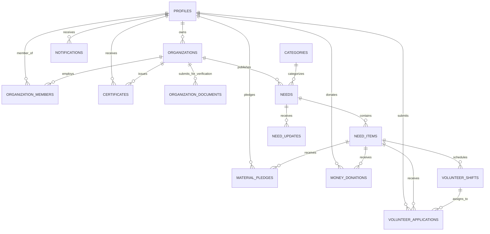

# GiveHand ET — Database Architecture & ERD Specification

## 1. Overview
GiveHand ET uses Supabase PostgreSQL with strict Row Level Security (RLS) enabled across every table. The database model covers three contribution dimensions (**Volunteering**, **Materials**, and **Money**), multi-tenant organization verification, automatic progress calculation via SQL views, and cryptographically verifiable certificates.

---

## 2. Entity-Relationship Diagram (ERD)

---

## 3. Core Tables Specification

| Table | Description | Primary Key | Key Foreign Keys | Key Constraints / Indexes |
|---|---|---|---|---|
| `profiles` | User profiles extending `auth.users` | `id (uuid)` | `auth.users(id)` | Role: `supporter`, `organization`, `admin` |
| `organizations` | NGOs, clinics, charities, schools | `id (uuid)` | `owner_id -> profiles(id)` | Unique `slug`, status enum |
| `organization_members` | Staff and managers in organizations | `id (uuid)` | `organization_id`, `user_id` | Unique `(organization_id, user_id)` |
| `organization_documents` | Verification licenses, tax IDs, bylaws | `id (uuid)` | `organization_id` | Status: `pending`, `approved`, `rejected` |
| `categories` | Cause areas (Education, Health, Food, etc.) | `id (uuid)` | - | Dual-language `name_en`, `name_am` |
| `needs` | Community support campaigns | `id (uuid)` | `organization_id`, `category_id` | Status enum, urgency flag |
| `need_items` | Specific contribution targets (3 types) | `id (uuid)` | `need_id` | Item type: `volunteer`, `material`, `money` |
| `volunteer_shifts` | Discrete shift time slots | `id (uuid)` | `need_item_id` | Capacity integer limit |
| `volunteer_applications` | Volunteer registrations and shift bookings | `id (uuid)` | `need_item_id`, `shift_id`, `user_id` | Unique `(need_item_id, user_id)` |
| `material_pledges` | Physical item pledges (books, blankets, Teff) | `id (uuid)` | `need_item_id`, `user_id` | Positive quantity check |
| `money_donations` | Monetary pledges & payments in ETB | `id (uuid)` | `need_item_id`, `user_id` | Payment method enum, anonymous flag |
| `certificates` | Verifiable credentials with public code | `id (uuid)` | `user_id`, `organization_id` | Unique `public_code` (`GH-YYYY-XXXXXX`) |
| `need_updates` | Impact reports and field progress stories | `id (uuid)` | `need_id`, `author_id` | Image attachment URL |
| `notifications` | User alerts and event updates | `id (uuid)` | `user_id` | Indexed by `(user_id, read_at)` |
| `reports` | Community moderation and fraud reports | `id (uuid)` | `reporter_id` | Target polymorphic reference |
| `audit_logs` | System security and audit trail | `id (uuid)` | `actor_id` | Append-only event history |

---

## 4. Computed SQL Views

### `need_item_progress`
Calculates real-time progress strictly from verified and confirmed milestones:
- **Volunteer slots**: Confirmed count / Target slots
- **Materials**: Received quantity / Target quantity
- **Monetary gifts**: Confirmed ETB amount / Target ETB amount
- Progress percentage safely capped between `0.0%` and `100.0%` without division-by-zero vulnerabilities.

### `need_overall_progress`
Aggregates overall progress percentage across all sub-items belonging to a need campaign.

---

## 5. Automated Database Triggers & Functions

1. **`handle_new_user()`**: Automatically inserts a matching `profiles` record whenever a user registers through Supabase Auth.
2. **`set_updated_at()`**: Automatically updates `updated_at` timestamp on record modification.
3. **`calculate_volunteer_hours()`**: Automatically computes volunteer hours logged when `checked_in_at` and `checked_out_at` timestamps are present.
4. **`check_volunteer_shift_capacity()`**: Rejects applications attempting to confirm volunteers once a shift reaches its maximum capacity.
5. **`generate_certificate_code()`**: Automatically assigns a unique code (`GH-YYYY-XXXXXX`) before certificate insertion.
6. **`notify_volunteer_application_change()`** & **`notify_money_donation_change()`**: Automatically records notification items when application or payment statuses transition.

---

## 6. Row Level Security (RLS) Summary

- **Public Access**: Can view verified organizations, active public needs, need items, shifts, categories, and verify public certificates by code.
- **Supporter Access**: Can view and edit only their own profile, applications, material pledges, donation history, and notifications.
- **Organization Access**: Can manage only the needs, shifts, verification documents, and pledge/donation confirmations belonging to their registered organization. Needs cannot transition to `open` unless the organization has status `verified`.
- **Donor Anonymity**: When `is_anonymous = true`, user ID details are hidden from public queries.
- **Admin Access**: Full management rights across all entities via `is_admin()` security definer function.
- **Storage Protection**: Private buckets (`org-documents`, `payment-proofs`) restrict access strictly to file owners, relevant organization managers, and system administrators.
